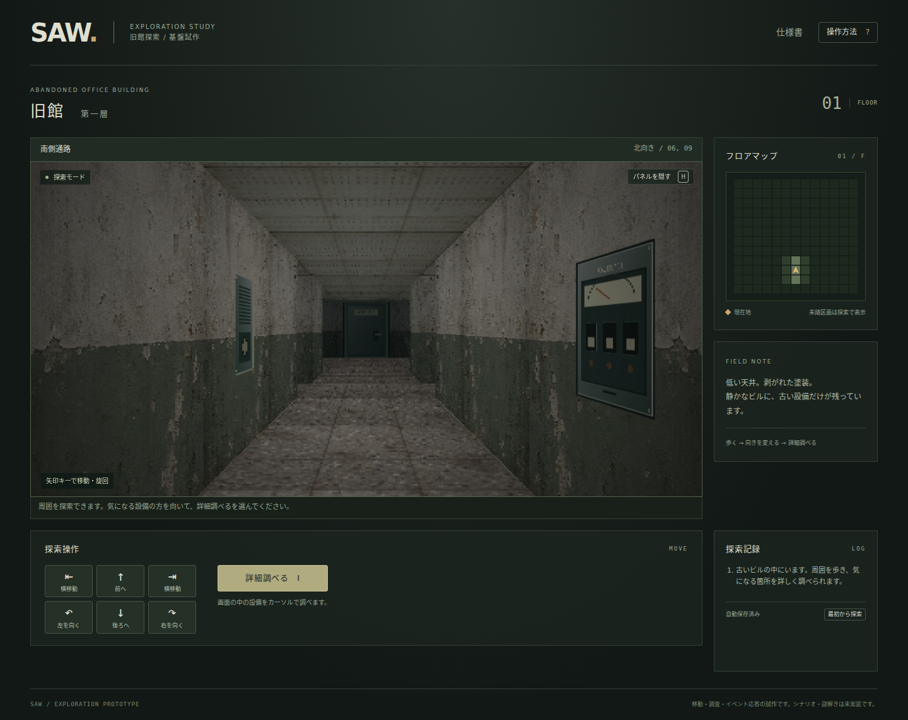

# SAW — 旧館探索

adv の一人称ダンジョン描画を移植した、脱出ゲームの探索基盤です。怪しげな現代風の古い事務所ビルを歩き、詳細調査モードで画面の設備をクリックできます。シナリオ、謎解き、アイテム取得、脱出条件はまだ実装していません。



## 起動

Node.js 22 以降で、リポジトリ直下から実行します。ゲーム本体には外部ライブラリー・CDN・ビルド処理が不要です。

```sh
npm run serve
```

ブラウザーで `http://127.0.0.1:8000` を開きます。HTMLの直接ダブルクリックではJSONを読み込めません。別ポートを使う場合は `PORT=8080 npm run serve` とします。

## 操作

↑↓ / W・Sで前後移動、←→ / A・Dで90度旋回します。Shift＋←→ / A・D、またはQ・Eでカニ歩きできます。画面の操作ボタンでも移動できます。

「詳細調べる」またはIキーで詳細調査に入ります。この間は移動・旋回が止まり、マウスを画面内の設備へ合わせてクリックすると応答します。右クリックは設備に補足イベントが定義されている場合に反応します。Escまたは「探索へ戻る」で終了します。

文章表示中はEnter / Space / Esc、または「閉じる」で進めます。Hまたは画面右上のボタンでパネルを隠す・戻す、F2で開発情報を切り替えます。タッチと、調査箇所一覧からのキーボード操作にも対応します。

入口から一歩前進して右を向くと配電盤があります。詳細調査でクリックすると表示灯と外観が切り替わります。イベント機構の試験設備であり、謎解きではありません。

位置・向き・地図・設備状態はブラウザーに自動保存します。「最初から探索」の確認操作で初期化できます。

## 仕様と制作

[仕様書の入口](doc/README.md)に操作、データ形式、マウスイベント、描画、素材、移植範囲、試験手順をまとめています。ブラウザー向けの[仕様書ビューアー](doc/index.html)も同梱しています。

素材は今回新規に作成しました。壁・床・天井は画像生成によるアトラス、設備は再生成可能なSVGです。移植元は `TomTomYoung/adv` の `65a82368ecda0fa823b1833adec954ea9182a013` です。詳細は[移植記録](doc/PORTING.md)と[素材仕様](doc/ASSETS.md)を参照してください。

## 検証

```sh
npm run check
npm ci
npx playwright install chromium
npm run test:browser
```

`check` は外部パッケージ不要です。ブラウザー検証だけPlaywrightを使用します。任意のChromium実行ファイルは `SAW_BROWSER_EXECUTABLE` で指定できます。

公開する場合は、このリポジトリ全体を静的HTTPサーバーに配置できます。サブディレクトリ配下でも動きます。GitHub Pagesを使う場合はリポジトリのPages設定でmainブランチのルートを指定してください。実装はPagesの設定を変更しません。
